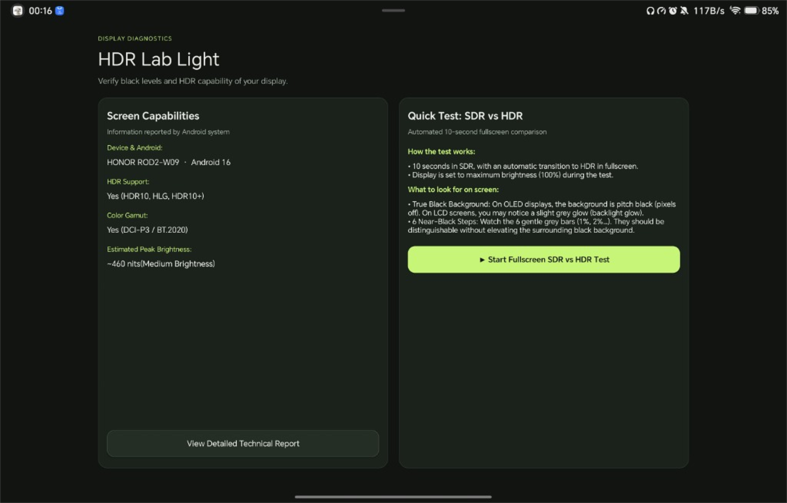
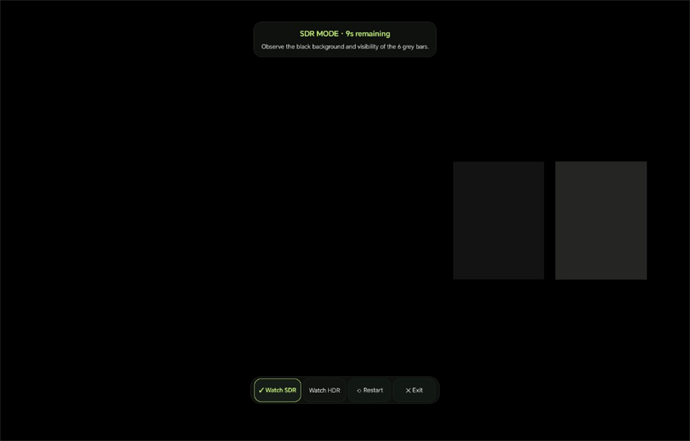

# HDR Lab Light 📱

Developing or reviewing the app? Start with the [development guide](docs/DEVELOPMENT.md) for setup, verification commands and the code map. [AGENTS.md](AGENTS.md) is the concise agent entry point; [architecture notes](docs/ARCHITECTURE.md) preserve hardware lessons and known issues.

> **Instant, privacy-first Android display diagnostic.** Test in 10 seconds if your screen delivers pure OLED blacks or suffers from raised grey blacks in HDR.

  

  
  
  

---

## ⚡ Fast 2-Minute Diagnostic

1. **Check Your Hardware:** Instantly detects your device model, custom OS (MagicOS, HyperOS, One UI, OxygenOS...), supported HDR standards (HDR10, HLG, Dolby Vision), and peak brightness in nits.
2. **Tap Test (10s):** Launches an automated fullscreen test with 100% brightness boost:
   * **0s to 10s:** SDR near-black pattern.
   * **At 10s:** Automatically transitions to HDR10 (PQ) at the exact same frame.

  

---

## 👁️ What to Look For

* **Background Surround (Pure Black):**  
  * **OLED / AMOLED:** Pixels must turn **completely off** (pitch black, seamlessly blending into a dark room).
  * **Raised Blacks Bug:** If the pitch-black background suddenly glows dark grey when HDR activates, your device is artificially elevating blacks.
* **6 Near-Black Steps (Shadow Detail):**  
  * All 6 subtle grey bars should be distinguishable without making the surrounding black background glow.
  * If the first 2 bars (1% and 2%) are invisible, your screen is **crushing shadows** ("black crush").

---

## 📋 Community Display Database

After running the test, tap **"Submit Community Report"** to optionally share your observations:
* Automatically detects and tags your device model, custom ROM (MagicOS, HyperOS, One UI, OxygenOS...), and hardware display specs.
* Evaluates SDR baseline vs. HDR transition black level and shadow step visibility.
* Directly appends your anonymous report to our open, crowd-sourced 10-column community database.
* Zero personal data, zero accounts, and 100% privacy guaranteed.

---

## 📥 Download

👉 **[Download Latest APK](https://github.com/xXCh1coriaXx/HDR-LAB/releases/latest)** *(~1.8 MB · Android 12+)*

* **100% Private & Open Source:** Zero trackers, zero ads, zero accounts.
* **Side-by-Side Coexistence:** Installs under `dev.hdrlab.light`, living peacefully alongside the pro version.
* **Pro Engineering Test Bench:** Looking for raw CTA-861 / ST 2086 metadata, YUV code values, or GPU tone mapping? Check the [`pro`](https://github.com/xXCh1coriaXx/HDR-LAB/tree/pro) branch.
