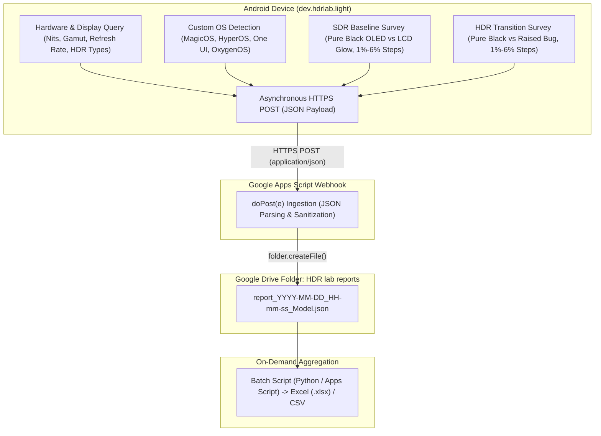

# HDR Lab Light — Community Display Calibration Database

> **Architecture, Google Drive Ingestion & JSON Telemetry Specification**  
> Documentation for the crowd-sourced calibration data bucket in **HDR Lab Light** (`dev.hdrlab.light`).

---

## 1. Overview & Data Flow

Evaluating HDR presentation across fragmented Android OEM skins (One UI, HyperOS, MagicOS, OxygenOS) requires community benchmarking. HDR Lab Light tests a 10-second SDR baseline followed by an exact-frame HDR transition, allowing users to voluntarily submit perceptual evaluations alongside rich hardware and display diagnostics.

To eliminate spreadsheet write locks, column misalignment, and mobile formatting issues, HDR Lab Light uses an **Event-Sourced JSON Bucket** architecture:
* Every test submission creates an **immutable, self-contained JSON document** inside a designated Google Drive folder.
* Submissions are processed through a serverless Google Apps Script webhook running `DriveApp.createFile()`.
* At any time, reports can be aggregated into Excel (`.xlsx`) or Google Sheets on demand.



---

## 2. Structured JSON Document Schema

Each report saved to Google Drive contains a structured JSON payload:

```json
{
  "survey": {
    "sdrBlackLevel": "Pure absolute black (OLED / Pixels off)",
    "sdrSteps": "All 6 steps visible (Excellent shadow detail)",
    "hdrBlackLevel": "Elevated / Glowed grey (Raised blacks bug in HDR)",
    "hdrSteps": "4 to 5 steps visible in HDR",
    "comments": "Observed in dark room, Natural color mode."
  },
  "device": {
    "manufacturer": "HONOR",
    "model": "ROD2-W09",
    "os": "MagicOS_10.0.0 (Android 16)",
    "androidRelease": "16",
    "sdkInt": 36,
    "hardware": "qcom",
    "socModel": "SM8650"
  },
  "display": {
    "peakBrightnessNits": 460,
    "minLuminanceNits": 0.0001,
    "maxAverageLuminanceNits": 460,
    "advertisedHdrTypes": ["HDR10", "HLG", "HDR10+"],
    "wideColorGamut": true,
    "activeMode": "2800 × 1840 @ 120.00 Hz",
    "reportedHdrSdrRatio": 1.0
  },
  "metadata": {
    "appVersion": "0.1.7",
    "appVersionCode": 8,
    "timestamp": 1729685000000,
    "timestampIso": "2026-10-23T12:00:00.000Z"
  }
}
```

---

## 3. Custom OS / ROM Mapping

Custom OEM video enhancers and dynamic contrast layers are detected via system properties:

| Vendor Skin | Primary System Property | Secondary / Fallback Property |
|---|---|---|
| **Honor MagicOS** | `ro.build.version.magic` | `ro.honor.build.version.incremental` |
| **Xiaomi HyperOS / MIUI** | `ro.mi.os.version.name` | `ro.miui.ui.version.name` |
| **Samsung One UI** | `ro.build.version.oneui` | `SEM_PLATFORM_INT` (Build.VERSION) |
| **OnePlus OxygenOS** | `ro.oxygen.version` | `ro.build.version.opporom` |
| **OPPO ColorOS** | `ro.build.version.opporom` | `ro.rom.different.version` |
| **Google Pixel UI** | `ro.build.flavor` | Google vendor build tags |
| **Stock AOSP / Fallback** | `Build.DISPLAY` | `"AOSP / Stock (" + Build.VERSION.RELEASE + ")"` |

---

## 4. Turnkey Google Apps Script (`Code.gs`)

Paste this code into **Extensions $\rightarrow$ Apps Script** in your Google Workspace:

```javascript
/**
 * HDR Lab Light — Community Display Database Ingestion Webhook
 * Receives JSON telemetry and saves individual report files into Google Drive.
 */

// Target Google Drive Folder: "HDR lab reports"
const TARGET_FOLDER_ID = "1VEHauaaZFqlIzDBNgHXb0RLlgMnkwoeb";

function doPost(e) {
  try {
    if (!e || !e.postData || !e.postData.contents) {
      return ContentService.createTextOutput("ERROR: Empty request body")
        .setMimeType(ContentService.MimeType.TEXT);
    }

    var folder = DriveApp.getFolderById(TARGET_FOLDER_ID);
    var raw = e.postData.contents;
    var data = null;

    // 1. Parse JSON body
    try {
      data = JSON.parse(raw);
    } catch (parseErr) {
      // Graceful fallback if sent as URL-encoded form parameters
      data = e.parameter || {};
    }

    // 2. Extract automatically discovered device name for clean filename
    var model = "device";
    if (data.deviceName && String(data.deviceName).trim().length > 0) {
      model = data.deviceName;
    } else {
      var mfg = data.manufacturer || (data.device && data.device.manufacturer) || "";
      var mdl = data.model || (data.device && data.device.model) || "";
      if (mfg && mdl) {
        model = mfg + "_" + mdl;
      } else if (mdl) {
        model = mdl;
      } else if (mfg) {
        model = mfg;
      }
    }
    var cleanModel = String(model).replace(/[^a-zA-Z0-9_\-\.]/g, "_").replace(/_+/g, "_");

    // 3. Generate timestamp string: YYYY-MM-DD_HH-mm-ss
    var now = new Date();
    var pad = function(n) { return (n < 10 ? "0" : "") + n; };
    var timeStamp = now.getUTCFullYear() + "-" +
                    pad(now.getUTCMonth() + 1) + "-" +
                    pad(now.getUTCDate()) + "_" +
                    pad(now.getUTCHours()) + "-" +
                    pad(now.getUTCMinutes()) + "-" +
                    pad(now.getUTCSeconds());

    var fileName = "report_" + timeStamp + "_" + cleanModel + ".json";

    // 4. Save file to Google Drive folder
    folder.createFile(fileName, JSON.stringify(data, null, 2), MimeType.PLAIN_TEXT);

    return ContentService.createTextOutput("SUCCESS: " + fileName)
      .setMimeType(ContentService.MimeType.TEXT);
  } catch (err) {
    return ContentService.createTextOutput("ERROR: " + err.message)
      .setMimeType(ContentService.MimeType.TEXT);
  }
}

function doGet(e) {
  return ContentService.createTextOutput("HDR Lab Light Drive Ingestion Webhook: READY")
    .setMimeType(ContentService.MimeType.TEXT);
}
```

### Deployment Instructions:
1. Open [Google Apps Script](https://script.google.com).
2. Paste the code above into `Code.gs` and click **Save** (disk icon).
3. In the top right, click **Deploy $\rightarrow$ Manage deployments** (or **New deployment**).
4. Click the **Edit** (pencil icon) next to your Web App.
5. Under **Version**, select **"New version"**.
6. Set **Who has access:** `Anyone`.
7. Click **Deploy**.

---

## 5. Privacy & Zero-Telemetry Guarantee

```
+-----------------------------------------------------------------------------------------+
|                               WHAT IS NEVER COLLECTED (ZERO)                            |
+-----------------------------------------------------------------------------------------+
|  [X] NO User Identity:          Zero names, email addresses, phone numbers, accounts.  |
|  [X] NO Device Hardware IDs:    Zero IMEI, MEID, Serial Number, or MAC Address.        |
|  [X] NO Persistent Tracking:    Zero Android ID (SSAID), Google Advertising ID (GAID). |
|  [X] NO Location Telemetry:     Zero GPS coordinates, Wi-Fi SSIDs/BSSIDs, Cell IDs.   |
|  [X] NO Media or File Data:     Zero user files, gallery content, or usage history.    |
|  [X] NO Cookies or Credentials: Zero OAuth tokens, session storage, or account linking.|
+-----------------------------------------------------------------------------------------+
```

* **No Background Telemetry:** The app never transmits data in the background or during normal video playback.
* **Explicit Opt-In:** Survey is presented only after the automated 10-second SDR-to-HDR test finishes.
* **Dismissible Without Penalty:** Tapping "Cancel" discards all entered data immediately.
