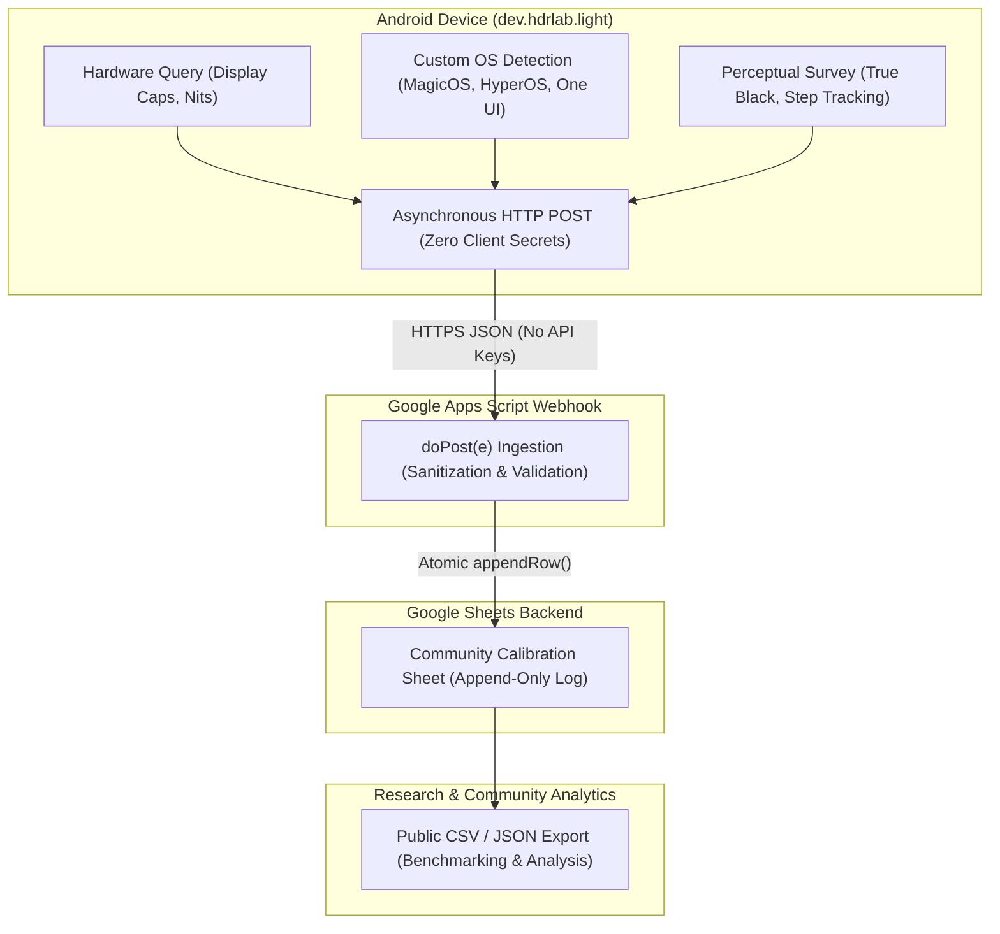

# HDR Lab Light — Community Display Calibration Database Architecture

> **Specification & Integration Guide**  
> Architecture, webhook implementation, field schema, and privacy specifications for the crowd-sourced display calibration database in **HDR Lab Light** (`dev.hdrlab.light`).

---

## 1. Overview & Motivation

Evaluating High Dynamic Range (HDR) presentation on Android is complicated by severe ecosystem fragmentation. Beyond physical panel variations (OLED vs. Mini-LED vs. standard LCD), vendor-specific custom Android distributions (e.g., Samsung One UI, Xiaomi HyperOS/MIUI, Honor MagicOS, OnePlus OxygenOS, OPPO ColorOS) introduce proprietary video processing layers, dynamic contrast enhancers, ambient tone-mapping adjustments, and custom Hardware Composer (`HWC`) composition pipelines.

These customizations frequently cause:
* **Elevated Black Floors (Raised Blacks):** OLED displays emitting perceptible light on reference code-black ($Y=64$ in 10-bit limited range) during PQ/HDR10 playback.
* **Near-Black Shadow Detail Crushing:** Aggressive tone-mapping curves collapsing the lowest quantization steps ($1\%$ and $2\%$ signal steps) into pitch black.
* **Color Clipping & Dynamic Contrast Shifting:** Content-adaptive brightness or vendor "AI Video Enhancers" altering gamma curves unpredictably.

To document and analyze these vendor behaviors at scale, **HDR Lab Light** incorporates a crowd-sourced display calibration database. This architecture enables users to voluntarily submit perceptual evaluation results alongside detected hardware parameters and custom OS identifiers to an open, centralized backend.



---

## 2. Google Forms & Google Sheets Backend Architecture

### A. Zero-Secret Ingestion Design
Traditional cloud backends (e.g., AWS API Gateway, Firebase, Supabase, Cloudflare Workers) require client-side authentication tokens, API keys, or service account credentials. Distributing API keys inside an open-source Android APK creates significant operational risks:
1. **Key Extraction & Abuse:** Anyone decompiling the APK can extract credentials and spam or exhaust cloud quotas.
2. **Billing & Infrastructure Overhead:** Managing cloud databases introduces recurring hosting costs and maintenance overhead.

To resolve this, HDR Lab Light employs a **zero-secret ingestion pipeline** using Google Apps Script deployed as a serverless Web App on Google Sheets (with Google Forms `formResponse` as an alternative submission vector).

#### How Asynchronous HTTP POST Works Without API Keys
* **Web App Deployment Permissions:** The Google Apps Script is deployed under the execution model:
  * **Execute as:** `Me` (the maintainer / project owner account).
  * **Who has access:** `Anyone` (allows anonymous incoming HTTP requests without requiring Google account authorization).
* **Asynchronous Android Dispatch:** When the user taps "Submit Report", the app initiates an asynchronous network call on a dedicated background thread (e.g., via standard Java `HttpURLConnection` or modern `OkHttp`):
  * **Target URL:** `https://script.google.com/macros/s/{DEPLOYMENT_ID}/exec`
  * **HTTP Method:** `POST`
  * **Headers:** `Content-Type: application/json; charset=UTF-8`
  * **Payload:** Serialized JSON payload containing hardware metadata and user survey responses.
* **Fail-Safe Operation:** If the device is offline or the request encounters a timeout, the submission fails gracefully with a non-intrusive UI message. Playback, local diagnostics, and test navigation are never blocked.

---

### B. Field Mappings & Data Schema

The database records 11 distinct attributes per submission. The table below outlines the mapping between the Android system source, the JSON payload key, the Google Sheet column, and the data format:

| Column # | Field Name | JSON Key | Data Source | Example Value | Description |
|---|---|---|---|---|---|
| **A** | **Timestamp** | `timestamp` | Server-generated (`ISO 8601`) or App dispatch time | `2026-10-23T00:45:00Z` | UTC timestamp of report submission. |
| **B** | **Manufacturer** | `manufacturer` | `android.os.Build.MANUFACTURER` | `Honor`, `Samsung`, `Xiaomi`, `Google` | Device hardware manufacturer. |
| **C** | **Model** | `model` | `android.os.Build.MODEL` | `PGT-N19`, `SM-S928B`, `Pixel 8 Pro` | Commercial / internal device model name. |
| **D** | **Custom OS / ROM** | `customOs` | System properties query (`ro.build.version...`) | `MagicOS 8.0`, `HyperOS 1.0`, `One UI 6.1` | Detected OEM vendor skin and version string. |
| **E** | **Android Version** | `androidVersion` | `Build.VERSION.RELEASE` (`SDK_INT`) | `14 (API 34)` | Underlying Android OS version and SDK level. |
| **F** | **HDR Types** | `hdrTypes` | `Display.HdrCapabilities.getSupportedHdrTypes()` | `HDR10, Dolby Vision, HLG` | Comma-separated list of display-supported HDR modes. |
| **G** | **Peak Nits** | `peakLuminanceNits` | `Display.HdrCapabilities.getDesiredMaxLuminance()` | `1000.0` or `-1` | Declared panel peak brightness in nits (-1 if not reported). |
| **H** | **Black Level Rating**| `blackLevelRating` | Perceptual user prompt (Survey) | `True Black (Zero Glow)`, `Raised Black Bug` | Visual assessment of reference code-black ($Y=64$). |
| **I** | **Visible Steps** | `visibleSteps` | Perceptual user prompt (Survey) | `Steps 1-6 (All Visible)`, `Steps 2-6 (Step 1 crushed)` | Visibility of the 6 calibrated near-black patches. |
| **J** | **User Notes** | `userNotes` | Optional freeform text field (max 500 chars) | `Video Enhancer disabled in settings. Ambient dark room.` | Qualitative observations, ambient lighting, or refresh rate. |
| **K** | **App Version** | `appVersion` | `BuildConfig.VERSION_NAME` | `0.1.5` | HDR Lab Light application version used for testing. |

---

### C. Custom OS / ROM Detection System Property Matrix

OEM skins directly influence video presentation pipelines. Below are the specific system properties checked by HDR Lab Light to populate the `customOs` field:

| Vendor Skin | Primary System Property | Secondary / Fallback Property |
|---|---|---|
| **Honor MagicOS** | `ro.build.version.magic` | `ro.honor.build.version.incremental` |
| **Xiaomi HyperOS / MIUI** | `ro.mi.os.version.name` | `ro.miui.ui.version.name` |
| **Samsung One UI** | `ro.build.version.oneui` | `ro.build.version.sep` |
| **OnePlus OxygenOS** | `ro.oxygen.version` | `ro.build.version.opporom` |
| **OPPO ColorOS** | `ro.build.version.opporom` | `ro.rom.different.version` |
| **Google Pixel UI** | `ro.build.flavor` (contains `cheetah`, `husky`, etc.) | Google vendor build tags |
| **Stock AOSP / Fallback** | `Build.DISPLAY` | `"AOSP / Stock (" + Build.VERSION.RELEASE + ")"` |

---

## 3. Google Apps Script Webhook Template (`doPost(e)`)

Maintainers can deploy this turnkey, hardened Google Apps Script snippet directly into Google Sheets. It automatically initializes sheet headers, validates incoming payloads, sanitizes input strings, and appends submissions atomically.

### Implementation Script (`Code.gs`)

```javascript
/**
 * HDR Lab Light — Community Display Calibration Ingestion Webhook
 *
 * Receives anonymous display calibration submissions via HTTP POST (JSON)
 * and records them into the active Google Sheet.
 *
 * Setup:
 * 1. Open Google Sheets -> Extensions -> Apps Script.
 * 2. Replace all contents in 'Code.gs' with this script.
 * 3. Click Deploy -> New deployment -> Select type: Web app.
 * 4. Execute as: 'Me', Who has access: 'Anyone'.
 * 5. Copy the generated Web App URL into the HDR Lab Light app configuration.
 */

// Schema definition matching the 11 columns in Section 2.B
const HEADERS = [
  "Timestamp",
  "Manufacturer",
  "Model",
  "Custom OS / ROM",
  "Android Version",
  "HDR Types",
  "Peak Nits",
  "Black Level Rating",
  "Visible Steps",
  "User Notes",
  "App Version"
];

/**
 * Handles incoming HTTP POST requests.
 * @param {Object} e - Event object containing postData.
 * @returns {TextOutput} JSON response with status and execution details.
 */
function doPost(e) {
  const lock = LockService.getScriptLock();
  // Wait up to 10 seconds for concurrent requests to clear
  const success = lock.tryLock(10000);
  if (!success) {
    return createJsonResponse({
      status: "error",
      message: "Server busy. Could not obtain script lock."
    }, 503);
  }

  try {
    // 1. Verify and parse request payload
    if (!e || !e.postData || !e.postData.contents) {
      return createJsonResponse({
        status: "error",
        message: "Empty or invalid request body."
      }, 400);
    }

    let payload;
    try {
      payload = JSON.parse(e.postData.contents);
    } catch (parseError) {
      return createJsonResponse({
        status: "error",
        message: "Failed to parse JSON content: " + parseError.toString()
      }, 400);
    }

    // 2. Select or initialize the target sheet
    const ss = SpreadsheetApp.getActiveSpreadsheet();
    let sheet = ss.getSheetByName("Submissions");
    if (!sheet) {
      sheet = ss.getActiveSheet();
      sheet.setName("Submissions");
    }

    // 3. Ensure header row exists
    if (sheet.getLastRow() === 0) {
      sheet.appendRow(HEADERS);
      sheet.getRange(1, 1, 1, HEADERS.length).setFontWeight("bold");
      sheet.setFrozenRows(1);
    }

    // 4. Extract and sanitize fields (defensive against missing/malformed keys)
    const timestamp = payload.timestamp ? String(payload.timestamp).trim() : new Date().toISOString();
    const manufacturer = sanitize(payload.manufacturer || "Unknown", 50);
    const model = sanitize(payload.model || "Unknown", 50);
    const customOs = sanitize(payload.customOs || "Stock / Unknown", 50);
    const androidVersion = sanitize(payload.androidVersion || "Unknown", 30);
    const hdrTypes = sanitize(payload.hdrTypes || "None", 100);
    
    // Parse numeric peak luminance; default to -1 if absent
    let peakNits = -1;
    if (payload.peakLuminanceNits !== undefined && payload.peakLuminanceNits !== null) {
      const parsed = parseFloat(payload.peakLuminanceNits);
      if (!isNaN(parsed) && isFinite(parsed)) {
        peakNits = Math.round(parsed * 10) / 10;
      }
    }

    const blackLevelRating = sanitize(payload.blackLevelRating || "Not Reported", 50);
    const visibleSteps = sanitize(payload.visibleSteps || "Not Reported", 50);
    const userNotes = sanitize(payload.userNotes || "", 500); // 500 char max limit
    const appVersion = sanitize(payload.appVersion || "0.1.5", 20);

    // 5. Build row array in strict column order
    const row = [
      timestamp,
      manufacturer,
      model,
      customOs,
      androidVersion,
      hdrTypes,
      peakNits >= 0 ? peakNits : "Not Reported",
      blackLevelRating,
      visibleSteps,
      userNotes,
      appVersion
    ];

    // 6. Append row atomically
    sheet.appendRow(row);

    return createJsonResponse({
      status: "success",
      message: "Display report recorded successfully.",
      rowInserted: sheet.getLastRow()
    }, 200);

  } catch (error) {
    return createJsonResponse({
      status: "error",
      message: "Internal server error: " + error.toString()
    }, 500);
  } finally {
    lock.releaseLock();
  }
}

/**
 * Handles incoming HTTP GET requests for service healthcheck and diagnostic status.
 */
function doGet(e) {
  return createJsonResponse({
    status: "ok",
    service: "HDR Lab Light Community Calibration Database Webhook",
    timestamp: new Date().toISOString()
  }, 200);
}

/**
 * Sanitizes input string to prevent cell formula injection and restrict length.
 * @param {string} input - Raw string.
 * @param {number} maxLen - Maximum allowed character length.
 * @returns {string} Sanitized string.
 */
function sanitize(input, maxLen) {
  let str = String(input).trim();
  // Prevent Google Sheets formula injection (=, +, -, @)
  if (str.startsWith("=") || str.startsWith("+") || str.startsWith("-") || str.startsWith("@")) {
    str = "'" + str;
  }
  if (str.length > maxLen) {
    str = str.substring(0, maxLen);
  }
  return str;
}

/**
 * Wraps output in valid JSON ContentService response with proper MIME type.
 * @param {Object} data - Payload to serialize.
 * @param {number} statusCode - HTTP status code (documented in JSON).
 * @returns {TextOutput} Formatted response.
 */
function createJsonResponse(data, statusCode) {
  data.code = statusCode;
  return ContentService.createTextOutput(JSON.stringify(data))
    .setMimeType(ContentService.MimeType.JSON);
}
```

---

### Step-by-Step Maintainer Deployment Guide

1. **Create the Destination Google Sheet:**
   - Navigate to [Google Sheets](https://sheets.new) and create a new spreadsheet.
   - Title the spreadsheet: `HDR Lab — Community Display Calibration Database`.
2. **Access Google Apps Script:**
   - In the Google Sheets top menu, click **Extensions** $\rightarrow$ **Apps Script**.
   - Rename the project from `Untitled project` to `HDR Lab Ingestion Webhook`.
3. **Insert Code:**
   - Delete any default code in `Code.gs` and paste the entire script from above.
   - Click the **Save** icon (diskette) or press `Ctrl + S`.
4. **Deploy as Web App:**
   - Click the blue **Deploy** button at the top right and select **New deployment**.
   - Click the gear icon next to "Select type" and choose **Web app**.
   - Fill out the deployment configuration:
     - **Description:** `HDR Lab Light Webhook v1`
     - **Execute as:** `Me (<your_email@gmail.com>)`
     - **Who has access:** `Anyone` *(Crucial: allows Android app submissions without login)*
   - Click **Deploy**.
5. **Authorize Permissions:**
   - Google will display an "Authorization required" prompt. Click **Authorize access**, choose your account, and grant spreadsheet edit permissions to the script.
6. **Obtain Web App URL:**
   - Copy the generated **Web app URL** (formatted as `https://script.google.com/macros/s/.../exec`).
   - This URL is used as the submission endpoint in `dev.hdrlab.light`.

---

## 4. Privacy, Transparency & Security Architecture

HDR Lab Light adheres to strict privacy-by-design standards. The application is built to serve display enthusiasts, calibrators, and academic researchers without gathering telemetry or tracking users.

### A. 100% Anonymous Telemetry Guarantee
The submission process is completely anonymous and collects **zero** personal or persistent identifying data:

```
+-----------------------------------------------------------------------------------------+
|                               WHAT IS NEVER COLLECTED (ZERO)                            |
+-----------------------------------------------------------------------------------------+
|  [X] NO User Identity:          Zero names, email addresses, phone numbers, accounts.  |
|  [X] NO Device Hardware IDs:    Zero IMEI, MEID, Serial Number, or MAC Address.        |
|  [X] NO Persistent Tracking:    Zero Android ID (SSAID), Google Advertising ID (GAID). |
|  [X] NO Location Telemetry:     Zero GPS coordinates, Wi-Fi SSIDs/BSSIDs, Cell IDs.   |
|  [X] NO Media or File Data:     Zero user files, gallery content, or usage history.    |
|  [X] NO Cookies or Credentials: Zero OAuth tokens, session storage, or account linking.|
+-----------------------------------------------------------------------------------------+
```

### B. What Is Collected (Exclusively Relevant Display Telemetry)
Submissions are strictly limited to technical display capabilities, OS version strings, and user perceptual ratings:
1. **Device Brand & Model:** `Build.MANUFACTURER` and `Build.MODEL` (e.g., "Honor PGT-N19").
2. **Custom OS Version String:** Querying public build properties (e.g., "MagicOS 8.0").
3. **Android Version:** `Build.VERSION.RELEASE` and API level.
4. **Display Capabilities:** Supported HDR formats (`HDR10`, `HLG`, `Dolby Vision`) and declared max luminance (`desiredMaxLuminance`).
5. **Perceptual Test Results:** Visual rating of reference black level (OLED true black vs. raised black bug) and visibility of the 6 calibrated near-black steps.
6. **Optional User Notes:** User-written observations regarding room environment, viewing conditions, or custom picture mode settings.

### C. Explicit Opt-In & Transparent Review Flow
* **No Background Telemetry:** The app never transmits data in the background or during normal video playback.
* **User-Triggered Survey:** The survey is presented only after the automated 10-second SDR-to-HDR comparison test finishes.
* **Pre-Submission Review:** The user can inspect the exact values being transmitted before confirming submission.
* **Dismissible Without Penalty:** The user can tap "Dismiss" or close the dialog at any point; no partial data is retained or cached.
* **Controlled Network Permission:** The `<uses-permission android:name="android.permission.INTERNET" />` declaration in `AndroidManifest.xml` is used exclusively for this user-initiated POST request.

### D. Security & Data Integrity Safeguards
1. **Formula Injection Sanitization:** The webhook sanitizes incoming strings (`sanitize()`) by escaping leading characters (`=`, `+`, `-`, `@`) to prevent malicious formula execution in Google Sheets.
2. **String Length Enforcement:** User notes and device fields enforce strict maximum string lengths (e.g., notes are capped at 500 characters) to prevent sheet cell exhaustion or denial-of-service payloads.
3. **Concurrency Locking:** The webhook utilizes `LockService.getScriptLock()` with a 10-second timeout to handle simultaneous submissions cleanly without dropped rows or race conditions.
4. **Transport Encryption:** All submissions travel exclusively over TLS/HTTPS directly to Google's infrastructure (`script.google.com`), preventing man-in-the-middle eavesdropping or payload tampering.
