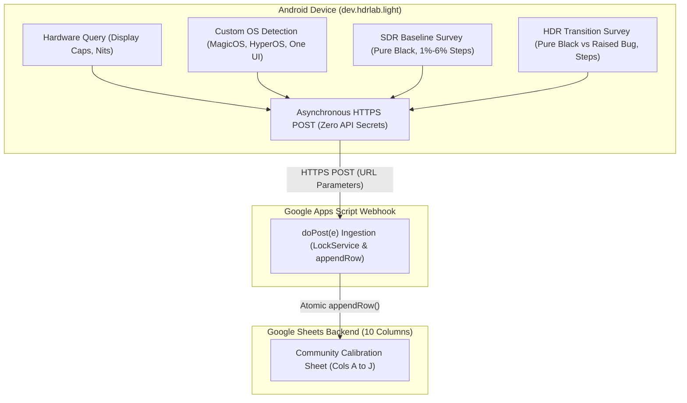

# HDR Lab Light — Community Display Calibration Database

> **Architecture, Webhook Implementation & 10-Column Schema**  
> Documentation for the crowd-sourced calibration database in **HDR Lab Light** (`dev.hdrlab.light`).

---

## 1. Overview & Data Flow

Evaluating HDR presentation across fragmented Android OEM skins (One UI, HyperOS, MagicOS, OxygenOS) requires community benchmarking. HDR Lab Light tests a 10-second SDR baseline followed by an exact-frame HDR transition, allowing users to submit comparative ratings to an open Google Sheets database via serverless Google Apps Script.



---

## 2. 10-Column Data Schema

| Col | Field Name | Parameter Key | Data Source | Example Value | Description |
|---|---|---|---|---|---|
| **A** | **Timestamp (UTC)** | `timestamp` | Server ISO 8601 | `2026-10-23T01:15:00.000Z` | UTC submission timestamp. |
| **B** | **Device Model** | `model` | `Build.MANUFACTURER + " " + Build.MODEL` | `HONOR ROD2-W09`, `Samsung SM-S928B` | Device brand and model. |
| **C** | **Operating System (OS)** | `os` | System properties query | `MagicOS 8.0`, `HyperOS 1.0`, `One UI 6.1` | Detected OEM skin and Android version. |
| **D** | **HDR Capabilities** | `hdr` | `Display.HdrCapabilities` | `Yes (HDR10, HLG, HDR10+)` | Supported HDR standards. |
| **E** | **Peak Brightness (Nits)** | `nits` | `desiredMaxLuminance` | `1000` or `Not reported` | Declared panel peak brightness. |
| **F** | **SDR Black Level** | `sdr_black` *(or `black_level`)* | User Survey (Q1) | `Pure absolute black (OLED / Pixels off)` | Baseline SDR black level. |
| **G** | **SDR Visible Steps** | `sdr_steps` *(or `steps_visible`)* | User Survey (Q2) | `All 6 steps visible (Excellent shadow detail)` | 1% to 6% shadow steps in SDR. |
| **H** | **HDR Black Level** | `hdr_black` | User Survey (Q3) | `Elevated / Glowed grey (Raised blacks bug)` | Black level after HDR transition. |
| **I** | **HDR Visible Steps** | `hdr_steps` | User Survey (Q4) | `4 to 5 steps visible in HDR` | 1% to 6% shadow steps in HDR. |
| **J** | **User Notes** | `comments` | User Survey (Q5) | `Dark room. Eye comfort disabled.` | Optional observations (max 500 chars). |

---

## 3. Vendor ROM System Property Matrix

| Vendor Skin | Primary System Property | Secondary / Fallback Property |
|---|---|---|
| **Honor MagicOS** | `ro.build.version.magic` | `ro.honor.build.version.incremental` |
| **Xiaomi HyperOS / MIUI** | `ro.mi.os.version.name` | `ro.miui.ui.version.name` |
| **Samsung One UI** | `ro.build.version.oneui` | `ro.build.version.sep` |
| **OnePlus OxygenOS** | `ro.oxygen.version` | `ro.build.version.opporom` |
| **OPPO ColorOS** | `ro.build.version.opporom` | `ro.rom.different.version` |
| **Google Pixel UI** | `ro.build.flavor` | Google vendor build tags |
| **Stock AOSP / Fallback** | `Build.DISPLAY` | `"AOSP / Stock (" + Build.VERSION.RELEASE + ")"` |

---

## 4. Turnkey Google Apps Script (`Code.gs`)

Paste this code into **Extensions $\rightarrow$ Apps Script** on your Google Sheet:

```javascript
/**
 * HDR Lab Light — Community Database Webhook
 * Appends 10 structured columns:
 * A: Timestamp | B: Model | C: OS | D: HDR | E: Nits
 * F: SDR Black | G: SDR Steps | H: HDR Black | I: HDR Steps | J: Notes
 */

function doPost(e) {
  var lock = LockService.getScriptLock();
  lock.tryLock(10000);
  
  try {
    var sheet = SpreadsheetApp.getActiveSpreadsheet().getActiveSheet();
    var data = (e && e.parameter) ? e.parameter : {};
    
    sheet.appendRow([
      new Date().toISOString(),
      data.model || "",
      data.os || "",
      data.hdr || "",
      data.nits || "",
      data.sdr_black || "",
      data.sdr_steps || "",
      data.hdr_black || data.black_level || "",
      data.hdr_steps || data.steps_visible || "",
      data.comments || ""
    ]);
    
    return ContentService.createTextOutput("SUCCESS")
      .setMimeType(ContentService.MimeType.TEXT);
  } catch (err) {
    return ContentService.createTextOutput("ERROR: " + err.message)
      .setMimeType(ContentService.MimeType.TEXT);
  } finally {
    lock.releaseLock();
  }
}

function doGet(e) {
  return ContentService.createTextOutput("HDR Lab Light Community Database Webhook: READY")
    .setMimeType(ContentService.MimeType.TEXT);
}
```

### Deployment:
1. Click **Deploy $\rightarrow$ New deployment** (or **Manage deployments $\rightarrow$ Edit $\rightarrow$ New version**).
2. Set **Execute as:** `Me` and **Who has access:** `Anyone`.
3. Copy the generated Web App URL and set it in `ReportSubmitter.java`.

---

## 5. Privacy & Zero-Telemetry Guarantee

```
+-----------------------------------------------------------------------------------------+
|                               WHAT IS NEVER COLLECTED (ZERO)                            |
+-----------------------------------------------------------------------------------------+
|  [X] NO User Identity:          Zero names, email addresses, phone numbers, accounts.  |
|  [X] NO Device Hardware IDs:    Zero IMEI, MEID, Serial Number, or MAC Address.        |
|  [X] NO Persistent Tracking:    Zero Android ID (SSAID), Google Advertising ID (GAID). |
|  [X] NO Location Telemetry:     Zero GPS coordinates, Wi-Fi SSIDs/BSSIDs, Cell IDs.   |
|  [X] NO Media or File Data:     Zero user files, gallery content, or usage history.    |
|  [X] NO Cookies or Credentials: Zero OAuth tokens, session storage, or account linking.|
+-----------------------------------------------------------------------------------------+
```

* **No Background Telemetry:** The app never transmits data in the background or during normal video playback.
* **Explicit Opt-In:** Survey is presented only after the automated 10-second SDR-to-HDR test finishes.
* **Dismissible Without Penalty:** Tapping "Cancel" discards all entered data immediately.
