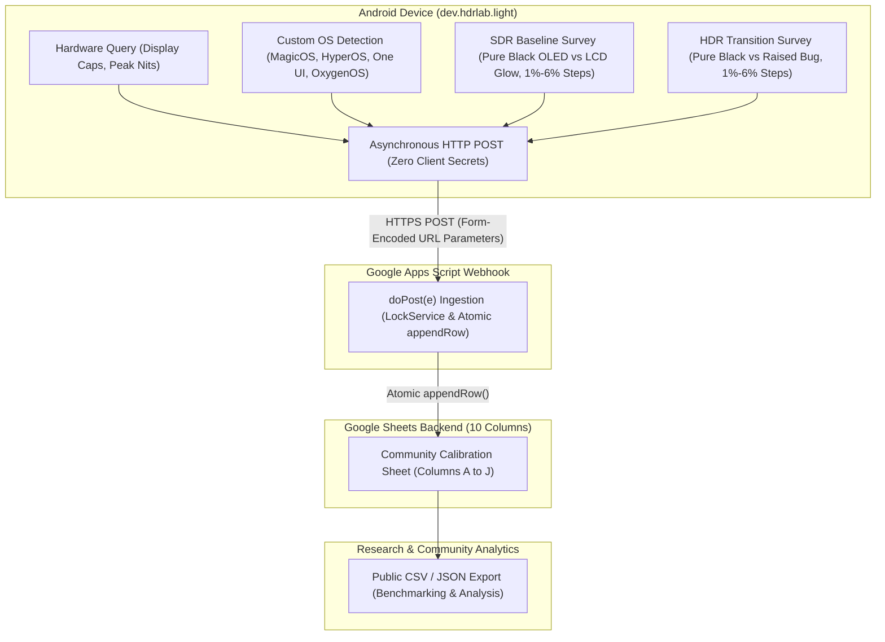

# HDR Lab Light — Community Display Calibration Database Architecture

> **Specification & Integration Guide**  
> Architecture, webhook implementation, field schema, and privacy specifications for the crowd-sourced display calibration database in **HDR Lab Light** (`dev.hdrlab.light`).

---

## 1. Overview & Motivation

Evaluating High Dynamic Range (HDR) presentation on Android is complicated by severe ecosystem fragmentation. Beyond physical panel variations (OLED vs. Mini-LED vs. standard LCD), vendor-specific custom Android distributions (e.g., Samsung One UI, Xiaomi HyperOS/MIUI, Honor MagicOS, OnePlus OxygenOS, OPPO ColorOS) introduce proprietary video processing layers, dynamic contrast enhancers, ambient tone-mapping adjustments, and custom Hardware Composer (`HWC`) composition pipelines.

These customizations frequently cause:
* **Elevated Black Floors (Raised Blacks):** OLED displays emitting perceptible light on reference code-black ($Y=64$ in 10-bit limited range) during PQ/HDR10 playback.
* **Near-Black Shadow Detail Crushing:** Aggressive tone-mapping curves collapsing the lowest quantization steps ($1\%$ and $2\%$ signal steps) into pitch black.
* **Color Clipping & Dynamic Contrast Shifting:** Content-adaptive brightness or vendor "AI Video Enhancers" altering gamma curves unpredictably.

To document and analyze these vendor behaviors at scale, **HDR Lab Light** incorporates a crowd-sourced display calibration database. By running a 10-second SDR baseline followed by an exact-frame HDR transition, users can evaluate both stages and voluntarily submit perceptual evaluation results alongside detected hardware parameters and custom OS identifiers to an open, centralized backend.



---

## 2. Google Sheets Backend Architecture

### A. Zero-Secret Ingestion Design
Traditional cloud backends (e.g., AWS API Gateway, Firebase, Supabase, Cloudflare Workers) require client-side authentication tokens, API keys, or service account credentials. Distributing API keys inside an open-source Android APK creates significant operational risks:
1. **Key Extraction & Abuse:** Anyone decompiling the APK can extract credentials and spam or exhaust cloud quotas.
2. **Billing & Infrastructure Overhead:** Managing cloud databases introduces recurring hosting costs and maintenance overhead.

To resolve this, HDR Lab Light employs a **zero-secret ingestion pipeline** using Google Apps Script deployed as a serverless Web App on Google Sheets.

#### How Asynchronous HTTP POST Works Without API Keys
* **Web App Deployment Permissions:** The Google Apps Script is deployed under the execution model:
  * **Execute as:** `Me` (the maintainer / project owner account).
  * **Who has access:** `Anyone` (allows anonymous incoming HTTP requests without requiring Google account authorization).
* **Asynchronous Android Dispatch:** When the user taps "Submit Report", the app initiates an asynchronous network call on a dedicated background thread via standard Java `HttpURLConnection`:
  * **Target URL:** `https://script.google.com/macros/s/{DEPLOYMENT_ID}/exec`
  * **HTTP Method:** `POST`
  * **Headers:** `Content-Type: application/x-www-form-urlencoded; charset=UTF-8`
  * **Payload:** URL-encoded key-value pairs matching the 10-column database schema.
* **Fail-Safe Operation:** If the device is offline or the request encounters a timeout, the submission fails gracefully with a non-intrusive UI message. Playback, local diagnostics, and test navigation are never blocked.

---

### B. Field Mappings & 10-Column Data Schema

The database records 10 distinct attributes per submission, comparing SDR baseline metrics directly against HDR transition behavior:

| Column # | Field Name | Parameter Key | Data Source | Example Value | Description |
|---|---|---|---|---|---|
| **A** | **Timestamp (UTC)** | `timestamp` | Server-generated (`ISO 8601`) or App dispatch time | `2026-10-23T01:15:00.000Z` | UTC timestamp of report submission. |
| **B** | **Device Model** | `model` | `Build.MANUFACTURER + " " + Build.MODEL` | `Honor PGT-N19`, `Samsung SM-S928B`, `Google Pixel 8 Pro` | Commercial / internal device manufacturer and model. |
| **C** | **Operating System (OS)** | `os` | System properties query (`ro.build.version...` / `Build.VERSION.RELEASE`) | `MagicOS 8.0`, `HyperOS 1.0`, `One UI 6.1`, `OxygenOS 14` | Detected OEM vendor skin and version, or stock Android. |
| **D** | **HDR Capabilities** | `hdr` | `Display.HdrCapabilities.getSupportedHdrTypes()` | `HDR10, Dolby Vision, HLG` | Comma-separated list of display-supported HDR standards. |
| **E** | **Peak Brightness (Nits)** | `nits` | `Display.HdrCapabilities.getDesiredMaxLuminance()` | `1000` or `Not reported` | Declared panel peak luminance in nits. |
| **F** | **SDR Black Level** | `sdr_black` *(or `black_level`)* | Perceptual user prompt (Survey) | `Pure black (OLED off)`, `Normal LCD glow` | Baseline black level during SDR near-black evaluation. |
| **G** | **SDR Visible Steps** | `sdr_steps` *(or `steps_visible`)* | Perceptual user prompt (Survey) | `Steps 1-6 (All Visible)`, `Steps 2-6 (Step 1 crushed)` | 1% to 6% shadow steps distinguishable in SDR. |
| **H** | **HDR Black Level** | `hdr_black` | Perceptual user prompt (Survey) | `Remained pure black (OLED)`, `Raised black bug (Glowed grey)` | Visual assessment of black level after HDR10 transition. |
| **I** | **HDR Visible Steps** | `hdr_steps` | Perceptual user prompt (Survey) | `Steps 1-6 (All Visible)`, `Steps 2-6 (Step 1 crushed)` | 1% to 6% shadow steps distinguishable in HDR. |
| **J** | **User Notes** | `comments` | Optional freeform text field (max 500 chars) | `Video Enhancer disabled in settings. Ambient dark room.` | Qualitative observations, ambient lighting, or picture mode. |

---

### C. Custom OS / ROM Detection System Property Matrix

OEM skins directly influence video presentation pipelines. Below are the specific system properties checked by HDR Lab Light to populate the `os` field:

| Vendor Skin | Primary System Property | Secondary / Fallback Property |
|---|---|---|
| **Honor MagicOS** | `ro.build.version.magic` | `ro.honor.build.version.incremental` |
| **Xiaomi HyperOS / MIUI** | `ro.mi.os.version.name` | `ro.miui.ui.version.name` |
| **Samsung One UI** | `ro.build.version.oneui` | `ro.build.version.sep` |
| **OnePlus OxygenOS** | `ro.oxygen.version` | `ro.build.version.opporom` |
| **OPPO ColorOS** | `ro.build.version.opporom` | `ro.rom.different.version` |
| **Google Pixel UI** | `ro.build.flavor` (contains `cheetah`, `husky`, etc.) | Google vendor build tags |
| **Stock AOSP / Fallback** | `Build.DISPLAY` | `"AOSP / Stock (" + Build.VERSION.RELEASE + ")"` |

---

## 3. Turnkey Google Apps Script Webhook Template (`doPost(e)`)

Maintainers can deploy this turnkey, hardened Google Apps Script snippet directly into Google Sheets. It receives incoming form-encoded or query parameters, handles concurrent requests with `LockService`, appends submissions atomically across all 10 columns, and provides backward-compatible fallback mapping for legacy field keys.

### Implementation Script (`Code.gs`)

```javascript
/**
 * HDR Lab Light — Community Display Calibration Ingestion Webhook
 *
 * Receives anonymous display calibration submissions via HTTP POST
 * and appends them atomically into the active Google Sheet across 10 columns.
 *
 * Column Layout:
 * A: Timestamp (UTC)  | B: Device Model        | C: Operating System (OS)
 * D: HDR Capabilities | E: Peak Nits           | F: SDR Black Level
 * G: SDR Visible Steps| H: HDR Black Level     | I: HDR Visible Steps
 * J: User Notes
 */

function doPost(e) {
  var lock = LockService.getScriptLock();
  lock.tryLock(10000);
  
  try {
    var sheet = SpreadsheetApp.getActiveSpreadsheet().getActiveSheet();
    var data = (e && e.parameter) ? e.parameter : {};
    
    sheet.appendRow([
      new Date().toISOString(),
      data.model || "",
      data.os || "",
      data.hdr || "",
      data.nits || "",
      data.sdr_black || data.black_level || "",
      data.sdr_steps || data.steps_visible || "",
      data.hdr_black || "",
      data.hdr_steps || "",
      data.comments || ""
    ]);
    
    return ContentService.createTextOutput("SUCCESS")
      .setMimeType(ContentService.MimeType.TEXT);
  } catch (err) {
    return ContentService.createTextOutput("ERROR: " + err.message)
      .setMimeType(ContentService.MimeType.TEXT);
  } finally {
    lock.releaseLock();
  }
}

/**
 * Diagnostic health check for the webhook URL.
 */
function doGet(e) {
  return ContentService.createTextOutput("HDR Lab Light Community Database Webhook: READY")
    .setMimeType(ContentService.MimeType.TEXT);
}
```

---

### Step-by-Step Maintainer Deployment Guide

1. **Create the Destination Google Sheet:**
   - Navigate to [Google Sheets](https://sheets.new) and create a new spreadsheet.
   - Title the spreadsheet: `HDR Lab — Community Display Calibration Database`.
   - In Row 1, set the 10 column headers:
     `Timestamp (UTC)`, `Device Model`, `Operating System (OS)`, `HDR Capabilities`, `Peak Brightness (Nits)`, `SDR Black Level`, `SDR Visible Steps`, `HDR Black Level`, `HDR Visible Steps`, `User Notes`.
   - Bold Row 1 and freeze it (**View** $\rightarrow$ **Freeze** $\rightarrow$ **1 row**).
2. **Access Google Apps Script:**
   - In the Google Sheets top menu, click **Extensions** $\rightarrow$ **Apps Script**.
   - Rename the project from `Untitled project` to `HDR Lab Ingestion Webhook`.
3. **Insert Code:**
   - Delete any default code in `Code.gs` and paste the script snippet above.
   - Click the **Save** icon (diskette) or press `Ctrl + S`.
4. **Deploy as Web App:**
   - Click the blue **Deploy** button at the top right and select **New deployment**.
   - Click the gear icon next to "Select type" and choose **Web app**.
   - Configure the deployment:
     - **Description:** `HDR Lab Light Webhook v0.1.6`
     - **Execute as:** `Me (<your_email@gmail.com>)`
     - **Who has access:** `Anyone` *(Allows Android submissions without authentication)*
   - Click **Deploy**.
5. **Authorize Permissions:**
   - Click **Authorize access**, choose your Google account, and grant spreadsheet edit permissions to the script.
6. **Obtain Web App URL:**
   - Copy the generated **Web app URL** (`https://script.google.com/macros/s/.../exec`).
   - This URL serves as the endpoint configured in `ReportSubmitter.java`.

---

## 4. Privacy, Transparency & Security Architecture

HDR Lab Light adheres to strict privacy-by-design standards. The application is built to serve display enthusiasts, calibrators, and academic researchers without gathering telemetry or tracking users.

### A. 100% Anonymous Telemetry Guarantee
The submission process is completely anonymous and collects **zero** personal or persistent identifying data:

```
+-----------------------------------------------------------------------------------------+
|                               WHAT IS NEVER COLLECTED (ZERO)                            |
+-----------------------------------------------------------------------------------------+
|  [X] NO User Identity:          Zero names, email addresses, phone numbers, accounts.  |
|  [X] NO Device Hardware IDs:    Zero IMEI, MEID, Serial Number, or MAC Address.        |
|  [X] NO Persistent Tracking:    Zero Android ID (SSAID), Google Advertising ID (GAID). |
|  [X] NO Location Telemetry:     Zero GPS coordinates, Wi-Fi SSIDs/BSSIDs, Cell IDs.   |
|  [X] NO Media or File Data:     Zero user files, gallery content, or usage history.    |
|  [X] NO Cookies or Credentials: Zero OAuth tokens, session storage, or account linking.|
+-----------------------------------------------------------------------------------------+
```

### B. What Is Collected (Exclusively Relevant Display Telemetry)
Submissions are strictly limited to technical display capabilities, OS version strings, and user perceptual ratings:
1. **Device Model:** `Build.MANUFACTURER + " " + Build.MODEL` (e.g., "Honor PGT-N19").
2. **Operating System:** Detected custom OS version (e.g., "MagicOS 8.0", "One UI 6.1") or stock Android version.
3. **Display Capabilities:** Supported HDR formats (`HDR10`, `HLG`, `Dolby Vision`) and declared max luminance.
4. **SDR Perceptual Baseline:** User rating of SDR black level (pure black OLED vs. normal LCD glow) and visible shadow steps ($1\%$ to $6\%$).
5. **HDR Perceptual Evaluation:** User rating of HDR black level (remained pure black vs. raised black bug) and visible shadow steps after HDR10 transition.
6. **Optional User Notes:** User-written observations regarding room environment, viewing conditions, or custom picture mode settings.

### C. Explicit Opt-In & Transparent Review Flow
* **No Background Telemetry:** The app never transmits data in the background or during normal video playback.
* **User-Triggered Survey:** The survey is presented only after the automated 10-second SDR-to-HDR comparison test finishes.
* **Pre-Submission Review:** The user can inspect the exact values being transmitted before confirming submission.
* **Dismissible Without Penalty:** The user can tap "Cancel" or dismiss the dialog at any point; no partial data is retained or cached.
* **Controlled Network Permission:** The `<uses-permission android:name="android.permission.INTERNET" />` declaration in `AndroidManifest.xml` is used exclusively for this user-initiated POST request.

### D. Security & Data Integrity Safeguards
1. **Concurrency Locking:** The webhook utilizes `LockService.getScriptLock()` with a 10-second timeout to handle simultaneous submissions cleanly without dropped rows or race conditions.
2. **Transport Encryption:** All submissions travel exclusively over TLS/HTTPS directly to Google's infrastructure (`script.google.com`), preventing man-in-the-middle eavesdropping or payload tampering.
3. **Hermetic Unit Testing:** Android unit tests run hermetically with mock endpoints to ensure network isolation during automated testing.
